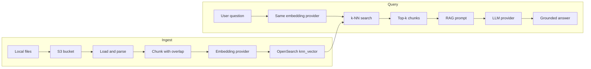

# Python RAG chatbot (Bedrock + LocalStack)

Small retrieval-augmented generation (RAG) chatbot. **S3** holds source documents and **OpenSearch** holds chunk embeddings. Locally those AWS APIs run on **LocalStack Community**. Embeddings and the chat model are pluggable: **sentence-transformers + Ollama** by default, **Amazon Bedrock** (Titan Embed + Converse) when you point the same code at real AWS.

LocalStack Community does **not** run Titan or Claude. Paid LocalStack Bedrock is an Ollama-backed API shim, not the real foundation models. This project therefore uses LocalStack where it is faithful (S3, OpenSearch) and a provider interface for embeddings and generation.

## Architecture



### Why each piece exists

| Component | Role |
|---|---|
| **S3** | Source of truth for files. Ingest can re-run from the bucket without keeping a second copy of the corpus on disk. |
| **Chunking** | Splits long documents so retrieval can return the relevant passage, not a whole file. Overlap keeps sentences that straddle a window. |
| **Embedding provider** | Turns text into vectors. Query and documents **must** use the same model and dimension. |
| **OpenSearch k-NN** | Vector database. Same client code talks to LocalStack or Amazon OpenSearch Service. |
| **LLM provider** | Writes the answer from retrieved snippets. It does not search; RAG does. |
| **LocalStack** | Local AWS API for S3 and OpenSearch so you can develop without an AWS account for those services. |

### Local vs AWS

| Concern | Local (Community LocalStack) | AWS |
|---|---|---|
| Document store | LocalStack S3 `http://localhost:4566` | Amazon S3 |
| Vector DB | LocalStack OpenSearch + `knn_vector` | Amazon OpenSearch Service |
| Embeddings | `all-MiniLM-L6-v2` (384-d) | `amazon.titan-embed-text-v2:0` (default 1024-d) |
| LLM | Ollama (`llama3.2`) | Bedrock `Converse` (e.g. Claude) |
| Auth | dummy `test` / `test` | IAM / SSO |

Changing embedding models **requires a re-ingest**. Do not mix dimensions in one index.

To move to AWS: unset `AWS_ENDPOINT_URL`, use real credentials, set `EMBEDDING_PROVIDER=bedrock` and `LLM_PROVIDER=bedrock`, create a real bucket and OpenSearch domain with the same names (or update `.env`), enable the Bedrock models in the console, then run ingest again.

## RAG workflow

1. **Ingestion** — local files are uploaded with `PutObject` (`python -m src.ingest`).
2. **Parse** — `.txt` / `.md` as UTF-8; `.pdf` via pypdf.
3. **Chunking** — recursive split (headings, paragraphs, sentences), then windows of `CHUNK_SIZE` with `CHUNK_OVERLAP`.
4. **Embedding** — each chunk becomes a vector (MiniLM or Titan).
5. **Vector storage** — OpenSearch documents `{text, source, chunk_id, offset, embedding}`.
6. **Query embedding** — the question is embedded with the **same** provider.
7. **Similarity search** — k-NN (`TOP_K` neighbors).
8. **Context retrieval** — snippets are numbered into the prompt.
9. **LLM response** — Ollama or Bedrock answers only from that context and cites filenames.

## Project layout

```
rag-bedrock-chatbot/
  README.md
  docker-compose.yml          # LocalStack; optional Ollama profile
  requirements.txt
  .env.example
  scripts/bootstrap_local.sh  # S3 bucket + OpenSearch domain
  data/sample/                # tiny Nimbus Desk knowledge base
  src/config.py               # env settings
  src/aws_clients.py          # boto3; LocalStack endpoint when set
  src/chunking.py             # splitter + Chunk metadata
  src/embeddings.py           # local MiniLM or Bedrock Titan
  src/vectorstore.py          # OpenSearch index / bulk / knn
  src/llm.py                  # Ollama chat or Bedrock Converse
  src/ingest.py               # upload, parse, chunk, embed, index
  src/rag.py                  # retrieve + prompt + generate
  src/chat.py                 # CLI loop
```

- **`config.py`** — loads `.env`; validates providers; exposes chunk size, top-k, model IDs, and embedding dimension.
- **`aws_clients.py`** — S3 and OpenSearch **control plane** via boto3. `endpoint_url` is set only for LocalStack. Bedrock runtime always uses real AWS (not Community LocalStack).
- **`chunking.py`** — recursive character split; each chunk keeps `source`, `chunk_id`, and byte `offset`.
- **`embeddings.py`** — `EmbeddingProvider.embed_texts` / `embed_query`.
- **`vectorstore.py`** — creates a `knn_vector` index (no extra HNSW/engine params, which break on some LocalStack versions), bulk indexes, k-NN query.
- **`llm.py`** — `generate(system, user)`.
- **`ingest.py`** — CLI: upload folder → read S3 → chunk → embed → rebuild index.
- **`rag.py`** — wires retrieve + grounded prompt.
- **`chat.py`** — REPL; prints answer and source keys.

## Local setup

### Required tools

- Python **3.11+**
- **Docker** (LocalStack; optional Ollama container)
- **AWS CLI v2** (bootstrap script)
- **Ollama** on the host, or `docker compose --profile ollama`

### Install

```bash
cd rag-bedrock-chatbot
python -m venv .venv
source .venv/bin/activate
pip install -r requirements.txt
cp .env.example .env
```

### Start LocalStack

```bash
docker compose up -d
./scripts/bootstrap_local.sh
```

The script creates bucket `rag-docs` and domain `rag-vectors`, then prints the OpenSearch URL. LocalStack is configured with `OPENSEARCH_ENDPOINT_STRATEGY=path` so the cluster is reachable without extra DNS.

### Start Ollama and pull a model

Host install:

```bash
ollama pull llama3.2
```

Or the compose profile (then set `OLLAMA_BASE_URL` if the API is not on `localhost:11434`):

```bash
docker compose --profile ollama up -d
docker compose exec ollama ollama pull llama3.2
```

### Ingest sample docs and chat

```bash
python -m src.ingest
python -m src.chat
```

Try: `How much is the Team plan?` or `What is the Sev1 response time on Enterprise?`

Re-index from files already in S3:

```bash
python -m src.ingest --skip-upload
```

### Python packages

From `requirements.txt`: `boto3`, `requests`, `opensearch-py`, `python-dotenv`, `pypdf`, `sentence-transformers`, `httpx`. There is no LangChain dependency.

### Environment (`.env.example`)

| Variable | Purpose |
|---|---|
| `AWS_ENDPOINT_URL` | LocalStack base URL; empty = real AWS for S3/OpenSearch |
| `S3_BUCKET` / `OPENSEARCH_DOMAIN` / `OPENSEARCH_INDEX` | Resource names |
| `EMBEDDING_PROVIDER` | `local` or `bedrock` |
| `LLM_PROVIDER` | `ollama` or `bedrock` |
| `CHUNK_SIZE` / `CHUNK_OVERLAP` / `TOP_K` | Split and retrieval |

First MiniLM download happens on the first ingest (Hugging Face).

## Optional: real Bedrock

1. IAM user or SSO identity with `bedrock:InvokeModel` / `bedrock:Converse` and access to S3 + OpenSearch.
2. Enable Titan Embeddings V2 and your chat model in the Bedrock console (region must match `AWS_DEFAULT_REGION`).
3. In `.env`: `EMBEDDING_PROVIDER=bedrock`, `LLM_PROVIDER=bedrock`, real keys. Leave `AWS_ENDPOINT_URL` set if S3/OpenSearch stay on LocalStack, or clear it for full AWS.
4. Align `BEDROCK_EMBEDDING_DIM` with the Titan request (default 1024) and run `python -m src.ingest` again.
